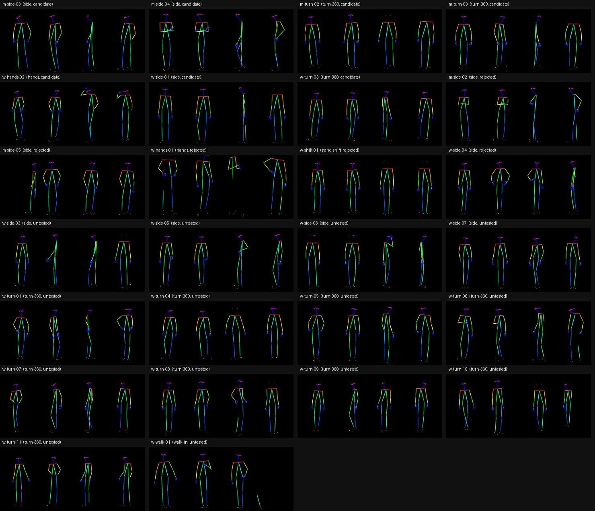

# Pose catalog (skeletons) — extracted, NOT validated

26 pose skeletons extracted with `motion_W1_extract-pose_v3` (SDPose whole-body, no face, with head) from studio product videos of fashion e-commerce stores (ASOS, Zalando). Each one is **5.2 s, 124 frames at 24 fps, 576×1024 (9:16)**, the same format as `look-02`.

> **Status (2026-11-27): not validated.** In W5 v20 most of these skeletons make stage 2 change the garment and paint the skeleton lines on it as stripes. The defect depends on the pose *and* the product: even `look-02` fails with a second product. All results below come from **one seed** and a sparse review, so a "pass" is not proof. The validation plan is in [`00_docs/plans/plan-2026-11-27-pose-catalog-and-inputs.md`](../../00_docs/plans/plan-2026-11-27-pose-catalog-and-inputs.md) (CHANGELOG #69).

## What is here
- `<pose>/pose.mp4`: the skeleton video (black background, body + hands + feet + head), 576×1024.
- `<pose>/pose-1.png` … `pose-4.png`: 4 skeleton frames spread over the clip.
- `catalog.csv`: one line per pose: gender, type, size, source store, local group (`candidate`, `rejected`, `untested`), W5 v20 result with the caramel product and with the navy polo product (1 seed each), skeleton notes.
- `contact_sheet.jpg`: the 4 thumbnails of every pose.

**Not here:** the original clips. They are third-party e-commerce videos, so they stay local only (`03_references/pose-videos/ecommerce/` and `input/motion/poses/<pose>/original.mp4` or `input/motion/poses_parked/*/<pose>/`).

## W5 v20 results so far (1 seed, sparse review)
| Group | Poses | Caramel product |
|---|---|---|
| candidate (passed once) | `m-side-03`, `m-side-04`, `m-turn-02`, `m-turn-03`, `w-hands-02`, `w-side-01`, `w-turn-03` | pass (`m-turn-03`: left arm looks like a sleeve) |
| rejected | `m-side-02`, `w-shift-01`, `w-side-04` (stripes), `m-side-05` (model cut by the frame at frame 0), `w-hands-01` (extra arms at frame 0, stripes) | fail |
| untested | the other 14 | — |

With the navy polo product: `look-02` fails (blue waves on the polo), `w-turn-03` has a red mark on the neck and an extra face reported by the user, `w-side-04` shows faint lines.

## Names
`<gender>-<type>-<nn>`: `w` women, `m` men. Types: `turn` (turn toward the back and/or back to the front), `side` (profile, look over the shoulder), `hands` (hands on hips, in the hair, on the garment), `shift` (weight shift, small moves), `walk` (walks toward the camera). Numbers have gaps: four planned clips (`m-side-01`, `m-turn-01`, `w-side-02`, `w-turn-02`) were dropped because the video cuts to a close-up before 5.2 s.

## Format notes
- The first extraction was 4:5 (800×1024, from ASOS 1080×1350). W5 renders 9:16, so the skeletons (and their original clips) were cropped around the body to 576×1024 like `look-02`. In 24 of 26 the body stays inside the crop; `m-side-05` (first 9 frames) and `w-walk-01` (last 10 frames) touch the edge.
- Frame 0 of `pose.mp4` is the pose of the first frame in W5.

## Known skeleton weak spots
- `w-hands-01`: the skeleton is lost for ~0.9 s while she bends forward (frames 65–85).
- `w-walk-01`: she walks out of frame in the last ~0.3 s.
- `w-turn-10`, `w-turn-11`: 3 weak frames each in the middle of the turn.
- In profile, SDPose sometimes drops one leg for a few frames.

## Local pages (not in the repo)
- `01_pipeline/scripts/pose_compare_page.py` → `input/motion/poses/compare.html`: original clip next to its skeleton.
- `01_pipeline/scripts/generation_report.py` → `report.mp4` per W5 generation + `output/motion/reports.html`: product | original | skeleton | generated.
