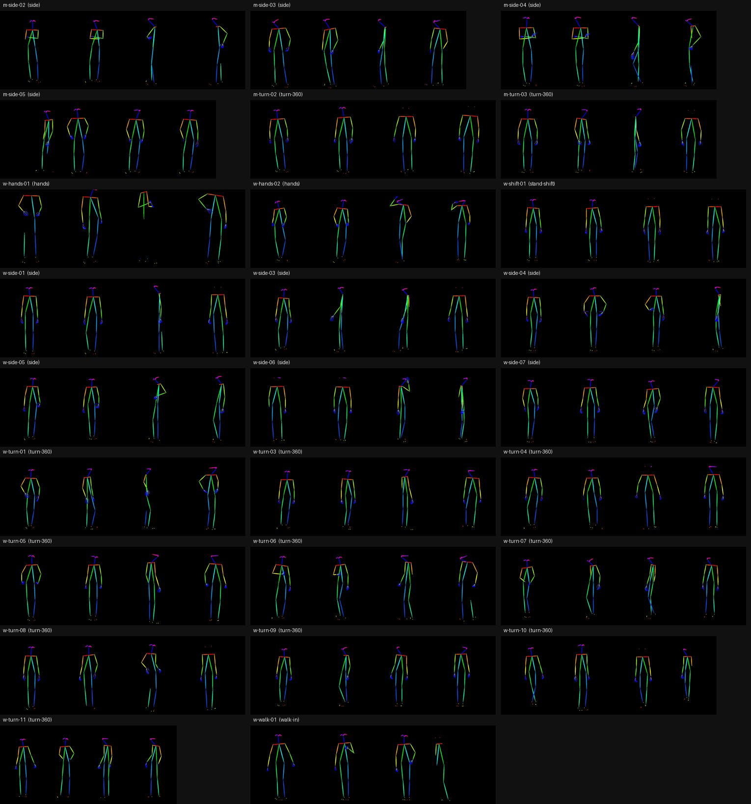

# Pose catalog (skeletons)

26 pose skeletons extracted with `motion_W1_extract-pose_v3` (SDPose whole-body, no face, with head) from studio product videos of fashion e-commerce stores (ASOS, Zalando). Each one is **5.2 s, 124 frames at 24 fps**: the same format W5 v20 reads, so any of them can replace `look-02`.

## What is here
- `<pose>/pose.mp4`: the skeleton video (black background, body + hands + feet + head).
- `<pose>/pose-1.png` … `pose-4.png`: 4 skeleton frames spread over the clip (catalog thumbnails).
- `catalog.csv`: one line per pose (gender, type, frames, fps, size, source store, notes).
- `contact_sheet.jpg`: the 4 thumbnails of every pose.

**Not here:** the original clips. They are third-party e-commerce videos, so they stay local only, in `3 - Assets/referencias de pose/ecommerce/` and next to each skeleton in ComfyUI's `input/motion/poses/<pose>/original.mp4`.

## Names
`<gender>-<type>-<nn>`: `w` women, `m` men. Types: `turn` (turn toward the back and/or back to the front), `side` (profile, look over the shoulder), `hands` (hands on hips, in the hair, on the garment), `shift` (weight shift, small moves), `walk` (walks toward the camera). Numbers have gaps: four planned clips (`m-side-01`, `m-turn-01`, `w-side-02`, `w-turn-02`) were dropped because the video cuts to a close-up before 5.2 s.

## Using a pose in W5
1. Copy the pose folder to ComfyUI's `input/motion/poses/<pose>/` (already there on the machine that made them).
2. In `motion_W5_quality_v20`, pick `motion/poses/<pose>/pose.mp4`.

Frame 0 of `pose.mp4` is the pose of the first frame in W5, so every clip starts with the model fully in frame.

Most skeletons are 800×1024 (4:5, from ASOS 1080×1350); the Zalando ones are 704×1024 or 576×1024. W5 renders 9:16, so check the framing on the first run of each size.

## Known weak spots
- `w-hands-01`: the skeleton is lost for ~0.9 s while she bends forward (frames 65–85).
- `w-walk-01`: she walks out of frame in the last ~0.3 s (frames 116–123).
- `w-turn-10`, `w-turn-11`: 3 weak frames each in the middle of the turn.

## Local comparison page
`2 - files/workflows/pose_compare_page.py` writes `input/motion/poses/compare.html` (local only): original clip and skeleton side by side, played in sync, with filters by gender and type.
