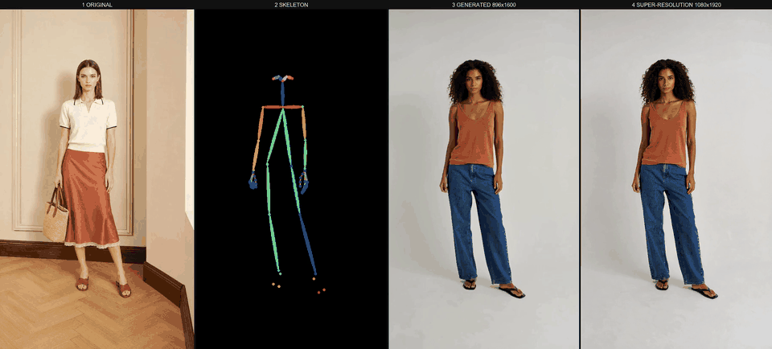
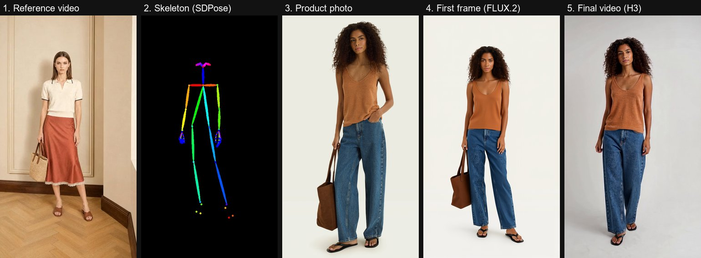
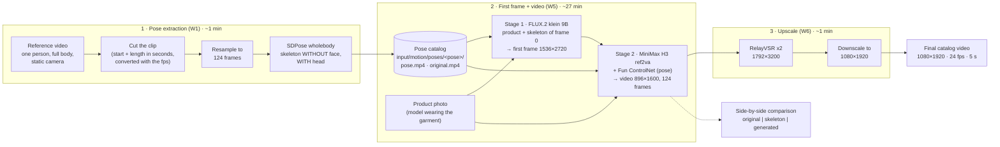
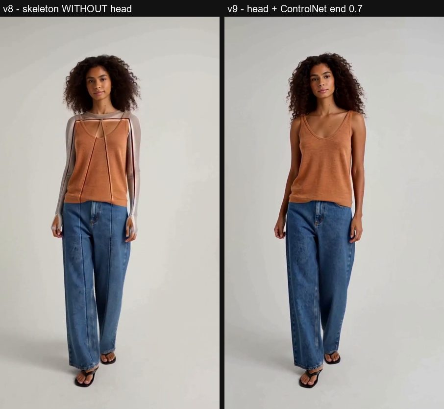
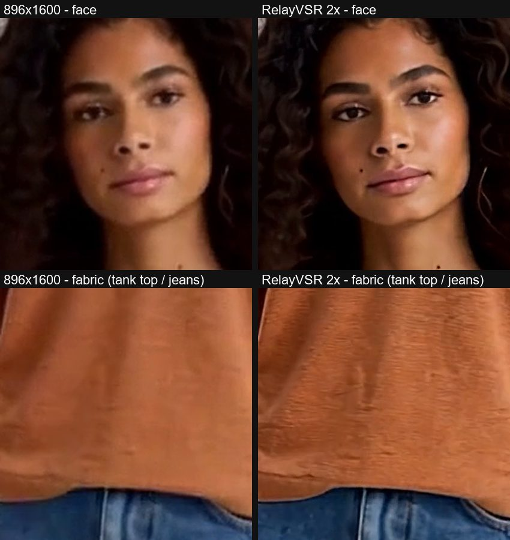

# Fashion pose-to-video

Generate short fashion catalog videos with motion transfer. The pipeline takes the movement from a reference video and applies it to a model wearing the product from your e-commerce photo. Everything runs locally in [ComfyUI](https://github.com/comfyanonymous/ComfyUI) with **native nodes only**: no custom nodes and no paid APIs.



**1 Original** (reference video) · **2 Skeleton** (extracted motion) · **3 Generated** (896×1600) · **4 Super-resolution** (1080×1920). Higher quality video: [`docs/media/example_4-stages.mp4`](docs/media/example_4-stages.mp4).



---

## Contents

- [How it works](#how-it-works)
- [The 3 production workflows](#the-3-production-workflows)
- [Step by step](#step-by-step)
- [Requirements](#requirements)
- [Models (download)](#models-download)
- [Input and output folders](#input-and-output-folders)
- [Base settings](#base-settings)
- [Results and lessons learned](#results-and-lessons-learned)
- [Repository layout](#repository-layout)
- [What is not in this repository](#what-is-not-in-this-repository)

---

## How it works

Pose extraction runs **once per movement** and goes into a pose catalog. After that, any product can be combined with any pose in the catalog.



**Why two stages?** The video starts from a first frame that already has the right garment in the right pose (stage 1, FLUX.2). H3 then animates from that frame, following the skeleton (stage 2), with the product photo as a reference. Making the frame first keeps the garment much more faithful than generating the video directly.

**The bridge between steps.** ComfyUI only lists files from its `input` folder, while the workflows save to `output`. The [`catalog.py`](2%20-%20files/workflows/catalog.py) script copies results into `input` with fixed names and never deletes anything; a replaced file is kept as `.previous-<date>`.

---

## The 3 production workflows

| # | Workflow (ComfyUI) | Input | What it does | Output |
|---|---|---|---|---|
| 1 | [`motion_W1_extract-pose_v3`](2%20-%20files/workflows/ui_production/motion_W1_extract-pose_v3.json) | reference video, pose name, clip start and length (default 5.2 s) | cuts the clip using the fps (`ComfyMathExpression`), resamples to 124 frames, runs SDPose → skeleton without face and with head, at 24 fps | `output/motion/catalog/<pose>/`: pose, original and 4 thumbnails of each |
| 2 | [`motion_W5_quality_v11`](2%20-%20files/workflows/ui_production/motion_W5_quality_v11.json) | product photo + `motion/poses/<pose>/pose.mp4` | stage 1: first frame (FLUX.2 klein 9B). Stage 2: video (H3 + ControlNet). The pose for the first frame is frame 0 of `pose.mp4` | `output/motion/production/<product>_<pose>/`: frame0 and video |
| 3 | [`motion_W6_upscale_v3`](2%20-%20files/workflows/ui_production/motion_W6_upscale_v3.json) | `motion/production/<name>.mp4` | RelayVSR x2, then downscale to 1080×1920; audio and fps copied from the input | same production folder: `video_2x` and `video_1080x1920` |

Every workflow exists in three forms in this repo:
- **UI** (`ui_production/*.json`): the file you open in ComfyUI, with groups and a usage note.
- **API** (`*_api.json`): the same graph in ComfyUI's API format.
- **Generator** (`build_*.py`): the Python script that writes the API JSON. It is the source of truth for each version.

The test workflows (W1 v1/v2, W2, W3a, W5 v1–v10, W6 v1/v2) are archived in [`ui_tests/`](2%20-%20files/workflows/ui_tests). Their labels are in Portuguese.

---

## Step by step

1. **Install the models** from the [table below](#models-download) into the folders shown.
2. **Import the 3 workflows** from `2 - files/workflows/ui_production/` into ComfyUI (drag the `.json` onto the canvas, or copy it to `ComfyUI/user/default/workflows/`).
3. **Extract a pose:** copy the reference video into `ComfyUI/input/`, open `motion_W1_extract-pose_v3`, fill in the pose name and the clip, and run it.
4. **Add the pose to the catalog:**
   ```bash
   python -I -X utf8 "2 - files/workflows/catalog.py" pose look-02
   ```
5. **Generate the video:** put the product photo in `input/` and open `motion_W5_quality_v11`. Pick the product and `motion/poses/<pose>/pose.mp4`, and name it `<product>_<pose>`. Run it (~27 min on an RTX 4090).
6. **Optional, comparison video:** builds the original | skeleton | generated video.
   ```bash
   python -I -X utf8 "2 - files/workflows/catalog.py" compare caramel-tank-jeans_look-02 look-02
   ```
7. **Upscale:**
   ```bash
   python -I -X utf8 "2 - files/workflows/catalog.py" upscale caramel-tank-jeans_look-02
   ```
   Open `motion_W6_upscale_v3`, pick `motion/production/<name>.mp4`, use the same name and run it (~1 min).

> **Paths:** `catalog.py` points to `D:\Comfy-Desktop\ComfyUI-Shared\input|output\motion`. Change the `IN` and `OUT` constants at the top of the file to match your install. Run it with ComfyUI's own Python (it needs `av` and `Pillow`, which ship with ComfyUI).

**Turning stages on and off:** right-click a group title and choose *Set Group Nodes to Never/Always*. This is built into ComfyUI. Use it, for example, to redo only the video without redoing the first frame.

**Good reference video:** one person, full body, static camera, good light, at least 5 s, ideally 24 fps and vertical 9:16.

**Good product photo:** the model from the front, full body. For videos with a turn, a back photo helps.

---

## Requirements

- **GPU:** tested on an NVIDIA RTX 4090 24 GB. Stage 2 at 896×1600 takes ~51 s per step and fits in 24 GB.
- **ComfyUI 0.46.2** (tested on ComfyUI Desktop), **no custom nodes**. Every node is native, including `SDPoseKeypointExtractor`, `MiniMaxH3*`, `RelayVSRConditioning`, `VSRDecode`, `ComfyMathExpression` and `VideoFrameSample`.
- **Disk:** ~69 GB of models.
- **Python** from ComfyUI itself for the scripts (`catalog.py`, `W4_*.py`, `build_*.py`).

---

## Models (download)

No model files are in this repository; download them from the original repositories. These are the same links used by the official ComfyUI templates.

| Folder in `ComfyUI/models/` | File | Size | Used in | Link |
|---|---|---:|---|---|
| `checkpoints/` | `sdpose_wholebody_fp16.safetensors` | 1.8 GB | W1 (skeleton) | [Comfy-Org/SDPose](https://huggingface.co/Comfy-Org/SDPose/resolve/main/checkpoints/sdpose_wholebody_fp16.safetensors) |
| `diffusion_models/` | `flux-2-klein-base-9b-fp8.safetensors` | 8.9 GB | W5 stage 1 | [black-forest-labs/FLUX.2-klein-base-9b-fp8](https://huggingface.co/black-forest-labs/FLUX.2-klein-base-9b-fp8) ¹ |
| `text_encoders/` | `qwen_3_8b_fp8mixed.safetensors` | 8.1 GB | W5 stage 1 | [Comfy-Org/flux2-klein-9B](https://huggingface.co/Comfy-Org/flux2-klein-9B/resolve/main/split_files/text_encoders/qwen_3_8b_fp8mixed.safetensors) |
| `vae/` | `flux2-vae.safetensors` | 320 MB | W5 stage 1 | [Comfy-Org/flux2-dev](https://huggingface.co/Comfy-Org/flux2-dev/resolve/main/split_files/vae/flux2-vae.safetensors) ² |
| `diffusion_models/` | `minimax_h3_ref2va_pruned_int8_convrot.safetensors` | 19.5 GB | W5 stage 2 | [Comfy-Org/MiniMax-H3](https://huggingface.co/Comfy-Org/MiniMax-H3/resolve/main/diffusion_models/minimax_h3_ref2va_pruned_int8_convrot.safetensors) |
| `text_encoders/` | `qwen3vl_32b_minimax_h3_nvfp4_awq.safetensors` | 14.6 GB | W5 stage 2 | [Comfy-Org/MiniMax-H3](https://huggingface.co/Comfy-Org/MiniMax-H3/resolve/main/text_encoders/qwen3vl_32b_minimax_h3_nvfp4_awq.safetensors) |
| `vae/` | `minimax_h3_video_vae_fp16.safetensors` | 4.8 GB | W5 stage 2 | [Comfy-Org/MiniMax-H3](https://huggingface.co/Comfy-Org/MiniMax-H3/resolve/main/vae/minimax_h3_video_vae_fp16.safetensors) |
| `vae/` | `minimax_h3_audio_vae_fp32.safetensors` | 577 MB | W5 stage 2 | [Comfy-Org/MiniMax-H3](https://huggingface.co/Comfy-Org/MiniMax-H3/resolve/main/vae/minimax_h3_audio_vae_fp32.safetensors) |
| `model_patches/` | `minimax_h3_fun_controlnet_union_pruned_int8_convrot.safetensors` | 2.1 GB | W5 stage 2 (pose ControlNet) | [Comfy-Org/MiniMax-H3](https://huggingface.co/Comfy-Org/MiniMax-H3/resolve/main/model_patches/minimax_h3_fun_controlnet_union_pruned_int8_convrot.safetensors) |
| `loras/` | `minimax_h3_ref2v_turbo_4step_v0.1_comfyui_bf16.safetensors` | 1.8 GB | W5, optional (turbo mode, off by default) | [Comfy-Org/MiniMax-H3](https://huggingface.co/Comfy-Org/MiniMax-H3/resolve/main/loras/minimax_h3_ref2v_turbo_4step_v0.1_comfyui_bf16.safetensors) |
| `diffusion_models/` | `relayvsr_x2_lightx2v_int8_convrot.safetensors` | 4.8 GB | W6 | [Comfy-Org/RelayVSR](https://huggingface.co/Comfy-Org/RelayVSR/resolve/main/diffusion_models/relayvsr_x2_lightx2v_int8_convrot.safetensors) |
| `vae/` | `relayvsr_flash_vae_x2_fp32.safetensors` | 121 MB | W6 | [Comfy-Org/RelayVSR](https://huggingface.co/Comfy-Org/RelayVSR/resolve/main/vae/relayvsr_flash_vae_x2_fp32.safetensors) |

¹ Gated repository: accept the Black Forest Labs license on Hugging Face before downloading.
² Use this full VAE. The `full_encoder_small_decoder` from the klein template makes the first frame blurry.

```text
ComfyUI/models/
├── checkpoints/
│   └── sdpose_wholebody_fp16.safetensors
├── diffusion_models/
│   ├── flux-2-klein-base-9b-fp8.safetensors
│   ├── minimax_h3_ref2va_pruned_int8_convrot.safetensors
│   └── relayvsr_x2_lightx2v_int8_convrot.safetensors
├── loras/
│   └── minimax_h3_ref2v_turbo_4step_v0.1_comfyui_bf16.safetensors
├── model_patches/
│   └── minimax_h3_fun_controlnet_union_pruned_int8_convrot.safetensors
├── text_encoders/
│   ├── qwen_3_8b_fp8mixed.safetensors
│   └── qwen3vl_32b_minimax_h3_nvfp4_awq.safetensors
└── vae/
    ├── flux2-vae.safetensors
    ├── minimax_h3_audio_vae_fp32.safetensors
    ├── minimax_h3_video_vae_fp16.safetensors
    └── relayvsr_flash_vae_x2_fp32.safetensors
```

---

## Input and output folders

Paths are relative to ComfyUI's `input` and `output` folders.

```text
input/
├── <reference-video>.mp4                   ← W1 input
└── motion/
    ├── products/<product>_front.png        ← product photos
    ├── poses/<pose>/                       ← catalog (catalog.py pose)
    │   ├── pose.mp4                        ← read by W5
    │   ├── original.mp4
    │   └── keyframes/pose-1..4.png, original-1..4.png
    └── production/<product>_<pose>.mp4     ← W6 input (catalog.py upscale)

output/motion/
├── catalog/<pose>/                         ← W1 output
│   ├── pose_00001_.mp4 · original_00001_.mp4
│   └── keyframes/
└── production/<product>_<pose>/            ← W5 and W6 outputs
    ├── frame0_00001_.png                   ← first frame (1536×2720)
    ├── video_00001_.mp4                    ← generated video (896×1600)
    ├── compare.mp4                         ← original | skeleton | generated
    ├── video_2x_00001_.mp4                 ← 1792×3200
    └── video_1080x1920_00001_.mp4          ← final video
```

---

## Base settings

| | Stage 1 · first frame | Stage 2 · video |
|---|---|---|
| Model | FLUX.2 klein 9B base fp8 + qwen_3_8b | MiniMax H3 ref2va int8 + qwen3vl 32B |
| References | image 1 = product (4 MP) · image 2 = skeleton of frame 0 (1 MP), via `ReferenceLatent` | ref 1 = product (`max`) · frame 0 = stage 1 output (`MiniMaxH3AddGuide`) |
| Resolution | 1536×2720 | 896×1600, 124 frames, 24 fps |
| Sampling | 28 steps · CFG 3.5 · euler | 20 steps · guidance 1.0 · res_multistep |
| Control | — | Fun ControlNet union, strength 1.0, **end_percent 0.7** |
| VAE | `flux2-vae` | video fp16 + audio fp32 |
| Seed | 20261121 (fixed) | 20261121 (fixed) |

The stage 1 prompt tells the model to copy the garment **only from image 1**, and the garment description field is left empty on purpose: when there is text describing the outfit, the text wins over the image.

---

## Results and lessons learned

The full log, with every change and the reason for it, is in [`CHANGELOG.md`](CHANGELOG.md).

### Cross-eyed or misplaced eyes → `end_percent 0.7`

The generated person's head has different proportions from the person in the reference video. The skeleton's eye and nose points land on the generated model's eyebrows, and the ControlNet pulls the eyes there. The fix was to release the ControlNet for the last 30% of the steps, which is when facial detail is drawn. Motion and garment did not change.


### Never remove the head from the skeleton

Without the head, the *union* ControlNet starts reading the stick figure as a line map and draws the skeleton lines onto the clothes.



### Upscaling adds sharpness but does not fix defects

RelayVSR x2 makes the face, hair and fabric texture much sharper, with a bit more contrast on the skin. Defects from the generation are still there, only more visible. That is why the face is fixed during generation.



### Other lessons

| Test | Result |
|---|---|
| Video at 704×1248 | faithful garment, deformed face (face ~100 px wide) |
| Video at 1088×1920 | good face, but **the garment changed** and it took 59 min: not viable locally |
| Video at 896×1600 | best balance: faithful garment, good face, ~18–27 min |
| Skeleton without the 68 face points | no effect on the face (kept, since it is cleaner) |
| Bag carried in the hand | shows up in the first frame but **disappears in the video** (the skeleton has no bag) |
| ComfyUI 0.46.2 bug | occasional `IndexError` in `free_memory` during VAEDecode; running again fixes it |

---

## Repository layout

```text
.
├── README.md
├── CHANGELOG.md                      log of every change (what, where, before → after, why)
├── CLAUDE.md                         project briefing for the AI assistant used to build it
├── 1 - AI instructions/              research notes (e.g. the face problem, plan A/B/C)
├── 2 - files/workflows/
│   ├── ui_production/                the 3 production workflows (open in ComfyUI)
│   ├── ui_tests/                     archived test workflows (Portuguese labels)
│   ├── build_*.py                    API JSON generators (one per version)
│   ├── *_api.json                    workflows in API format
│   ├── catalog.py                    output → input bridge (pose, upscale, compare, list)
│   ├── W4_side_by_side.py            original | skeleton | generated video
│   └── W4_compare_versions.py        N videos side by side (--height, --frames)
├── 3 - Assets/referencias de pose/   reference videos (not versioned)
└── docs/media/                       video, GIF and images used in this README
```

**Project rules:**
- A change to a workflow becomes a new version (`_v2`, `_v3`…); nothing is overwritten.
- Every change goes into `CHANGELOG.md`.
- Every comparison becomes a side-by-side video.

---

## What is not in this repository

- **Models:** download them from the links above.
- **Reference videos** (`3 - Assets/`): third-party content, not versioned.
- **ComfyUI outputs**, apart from the examples in `docs/media/`.

The project was built with the help of [Claude Code](https://claude.com/claude-code). `CLAUDE.md` holds the briefing the assistant works from.
