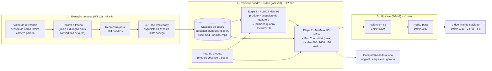
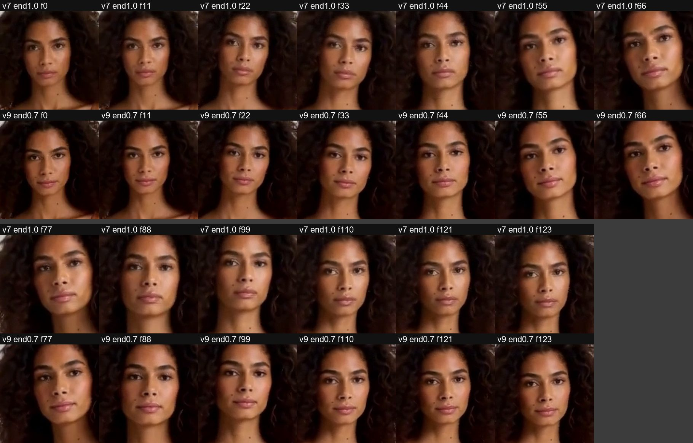
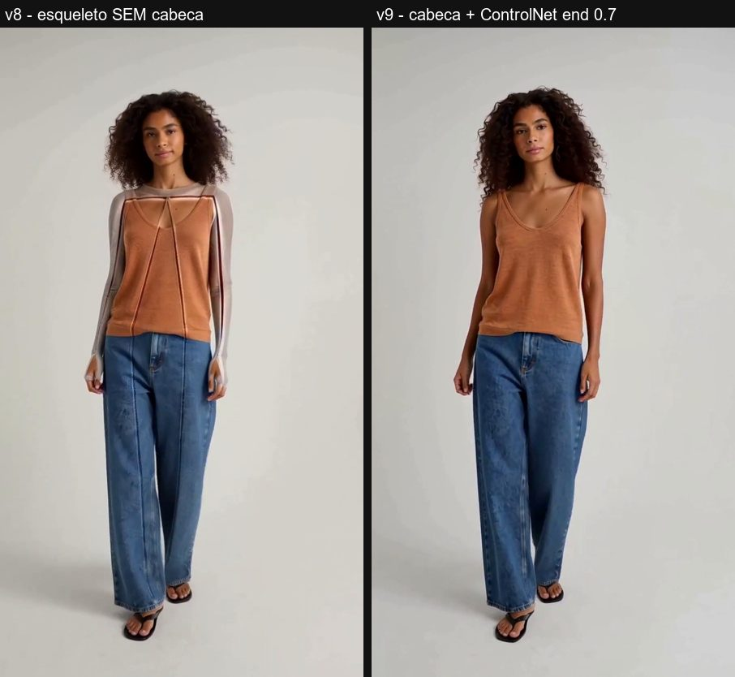
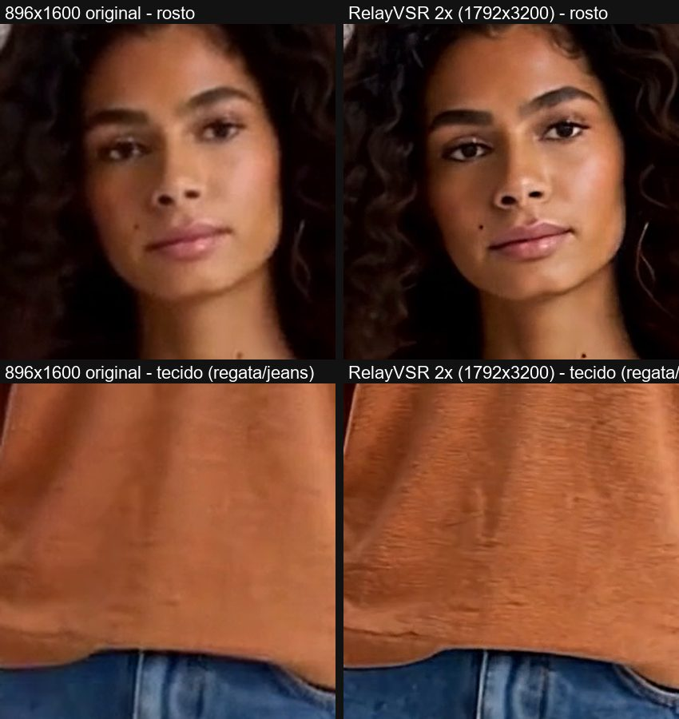

# Fashion pose-to-video

Este projeto gera vídeos curtos de catálogo de moda com transferência de movimento. Ele pega o movimento de um vídeo de referência e aplica numa modelo vestindo a peça do e-commerce. Tudo roda localmente no [ComfyUI](https://github.com/comfyanonymous/ComfyUI), só com nós nativos e sem gastar crédito de API.


**1 Original** (vídeo de referência) · **2 Esqueleto** (movimento extraído) · **3 Gerado** (896×1600) · **4 Super-resolução** (1080×1920). Vídeo em melhor qualidade: [`docs/media/exemplo_4-etapas.mp4`](docs/media/exemplo_4-etapas.mp4).


---

## Sumário

- [Como funciona](#como-funciona)
- [Os 3 workflows de produção](#os-3-workflows-de-produção)
- [Passo a passo](#passo-a-passo)
- [Requisitos](#requisitos)
- [Modelos (download)](#modelos-download)
- [Pastas de entrada e saída](#pastas-de-entrada-e-saída)
- [Configuração da base (W5 v9/v10)](#configuração-da-base-w5-v9v10)
- [Resultados e aprendizados](#resultados-e-aprendizados)
- [Estrutura do repositório](#estrutura-do-repositório)
- [O que não está no repositório](#o-que-não-está-no-repositório)

---

## Como funciona

A extração da pose acontece **uma vez por movimento**, e o resultado vai para um catálogo de poses. Depois, cada produto pode ser combinado com qualquer pose do catálogo.



**Por que em duas etapas?** O vídeo começa de um primeiro quadro que já tem a roupa certa na pose certa (Etapa 1, FLUX.2). O H3 então anima a partir desse quadro seguindo o esqueleto (Etapa 2), usando a foto do produto como referência. Fazer o quadro antes deixa a roupa bem mais fiel do que gerar o vídeo direto.

**A ponte entre os passos.** O ComfyUI só lista arquivos da pasta `input`, e os workflows salvam em `output`. O script [`catalogo.py`](2%20-%20files/workflows/catalogo.py) copia os resultados para `input` com nomes fixos e nunca apaga nada; um arquivo substituído é guardado como `.anterior-<data>`.

---

## Os 3 workflows de produção

| # | Workflow (ComfyUI) | Entrada | Faz | Saída |
|---|---|---|---|---|
| 1 | [`motion_W1_extrai-pose_v2`](2%20-%20files/workflows/ui_producao/motion_W1_extrai-pose_v2.json) | vídeo de referência, nome da pose, início e duração do trecho (padrão 5,2 s) | recorta pelo fps (`ComfyMathExpression`), reamostra para 124 quadros, SDPose → esqueleto sem rosto e com cabeça, a 24 fps | `output/motion/catalogo/<pose>/` pose, original e 4 miniaturas de cada |
| 2 | [`motion_W5_qualidade_v10`](2%20-%20files/workflows/ui_producao/motion_W5_qualidade_v10.json) | foto do produto + `motion/poses/<pose>/pose.mp4` | Etapa 1: primeiro quadro (FLUX.2 klein 9B). Etapa 2: vídeo (H3 + ControlNet). A pose do primeiro quadro é o quadro 0 do `pose.mp4` | `output/motion/producao/<produto>_<pose>/` frame0 e vídeo |
| 3 | [`motion_W6_upscale_v2`](2%20-%20files/workflows/ui_producao/motion_W6_upscale_v2.json) | `motion/producao/<nome>.mp4` | RelayVSR x2, depois redução para 1080×1920; áudio e fps copiados da entrada | mesma pasta de produção: `video_2x` e `video_1080x1920` |

Cada workflow tem três formas no repositório:
- **UI** (`ui_producao/*.json`): o arquivo que você abre no ComfyUI, com grupos e nota de uso.
- **API** (`*_api.json`): o mesmo grafo no formato da API do ComfyUI.
- **Gerador** (`build_*.py`): o script Python que escreve o API-JSON. É a fonte de verdade de cada versão.

Os workflows de teste (W1 v1, W2, W3a, W5 v1–v9, W6 v1) ficam em [`ui_testes/`](2%20-%20files/workflows/ui_testes) e não aparecem no ComfyUI.

---

## Passo a passo

1. **Instale os modelos** da [tabela abaixo](#modelos-download) nas pastas indicadas.
2. **Importe os 3 workflows** de `2 - files/workflows/ui_producao/` no ComfyUI (arraste o `.json` para a tela, ou copie para `ComfyUI/user/default/workflows/`).
3. **Extraia uma pose:** copie o vídeo de referência para `ComfyUI/input/`, abra a `motion_W1_extrai-pose_v2`, preencha o nome da pose e o trecho, e rode.
4. **Leve a pose para o catálogo:**
   ```bash
   python -I -X utf8 "2 - files/workflows/catalogo.py" pose look-02
   ```
5. **Gere o vídeo:** coloque a foto do produto em `input/` e abra a `motion_W5_qualidade_v10`. Escolha o produto e `motion/poses/<pose>/pose.mp4`, e dê o nome `<produto>_<pose>`. Rode (~27 min numa RTX 4090).
6. **Opcional, comparativo:** gera o vídeo original | esqueleto | gerado.
   ```bash
   python -I -X utf8 "2 - files/workflows/catalogo.py" comparativo regata-caramelo-jeans_look-02 look-02
   ```
7. **Faça o upscale:**
   ```bash
   python -I -X utf8 "2 - files/workflows/catalogo.py" upscale regata-caramelo-jeans_look-02
   ```
   Abra a `motion_W6_upscale_v2`, escolha `motion/producao/<nome>.mp4`, use o mesmo nome e rode (~1 min).

> **Caminhos:** `catalogo.py` aponta para `D:\Comfy-Desktop\ComfyUI-Shared\input|output\motion`. Ajuste as constantes `IN` e `OUT` no topo do arquivo para a sua instalação. Rode com o Python do ambiente do ComfyUI (precisa de `av` e `Pillow`, que já vêm com ele).

**Liga e desliga etapas:** clique com o botão direito no título de um grupo e escolha *Set Group Nodes to Never/Always*. Isso é nativo do ComfyUI, e serve por exemplo para refazer só o vídeo sem refazer o primeiro quadro.

**Bom vídeo de referência:** uma pessoa de corpo inteiro, câmera parada, boa luz, pelo menos 5 s, de preferência 24 fps e vertical 9:16.

**Boa foto de produto:** modelo de frente, corpo inteiro. Para vídeos com giro, uma foto de costas ajuda.

---

## Requisitos

- **GPU:** testado numa NVIDIA RTX 4090 24 GB. A Etapa 2 a 896×1600 usa ~51 s por passo e cabe nos 24 GB.
- **ComfyUI 0.46.2** (testado no ComfyUI Desktop), **sem custom nodes**. Todos os nós são nativos, incluindo `SDPoseKeypointExtractor`, `MiniMaxH3*`, `RelayVSRConditioning`, `VSRDecode`, `ComfyMathExpression` e `VideoFrameSample`.
- **Disco:** ~69 GB de modelos.
- **Python** do próprio ComfyUI para os scripts (`catalogo.py`, `W4_*.py`, `build_*.py`).

---

## Modelos (download)

Nenhum modelo está neste repositório; baixe dos repositórios originais. Os links são os mesmos dos templates oficiais do ComfyUI.

| Pasta em `ComfyUI/models/` | Arquivo | Tamanho | Usado em | Link |
|---|---|---:|---|---|
| `checkpoints/` | `sdpose_wholebody_fp16.safetensors` | 1,8 GB | W1 (esqueleto) | [Comfy-Org/SDPose](https://huggingface.co/Comfy-Org/SDPose/resolve/main/checkpoints/sdpose_wholebody_fp16.safetensors) |
| `diffusion_models/` | `flux-2-klein-base-9b-fp8.safetensors` | 8,9 GB | W5 Etapa 1 | [black-forest-labs/FLUX.2-klein-base-9b-fp8](https://huggingface.co/black-forest-labs/FLUX.2-klein-base-9b-fp8) ¹ |
| `text_encoders/` | `qwen_3_8b_fp8mixed.safetensors` | 8,1 GB | W5 Etapa 1 | [Comfy-Org/flux2-klein-9B](https://huggingface.co/Comfy-Org/flux2-klein-9B/resolve/main/split_files/text_encoders/qwen_3_8b_fp8mixed.safetensors) |
| `vae/` | `flux2-vae.safetensors` | 320 MB | W5 Etapa 1 | [Comfy-Org/flux2-dev](https://huggingface.co/Comfy-Org/flux2-dev/resolve/main/split_files/vae/flux2-vae.safetensors) ² |
| `diffusion_models/` | `minimax_h3_ref2va_pruned_int8_convrot.safetensors` | 19,5 GB | W5 Etapa 2 | [Comfy-Org/MiniMax-H3](https://huggingface.co/Comfy-Org/MiniMax-H3/resolve/main/diffusion_models/minimax_h3_ref2va_pruned_int8_convrot.safetensors) |
| `text_encoders/` | `qwen3vl_32b_minimax_h3_nvfp4_awq.safetensors` | 14,6 GB | W5 Etapa 2 | [Comfy-Org/MiniMax-H3](https://huggingface.co/Comfy-Org/MiniMax-H3/resolve/main/text_encoders/qwen3vl_32b_minimax_h3_nvfp4_awq.safetensors) |
| `vae/` | `minimax_h3_video_vae_fp16.safetensors` | 4,8 GB | W5 Etapa 2 | [Comfy-Org/MiniMax-H3](https://huggingface.co/Comfy-Org/MiniMax-H3/resolve/main/vae/minimax_h3_video_vae_fp16.safetensors) |
| `vae/` | `minimax_h3_audio_vae_fp32.safetensors` | 577 MB | W5 Etapa 2 | [Comfy-Org/MiniMax-H3](https://huggingface.co/Comfy-Org/MiniMax-H3/resolve/main/vae/minimax_h3_audio_vae_fp32.safetensors) |
| `model_patches/` | `minimax_h3_fun_controlnet_union_pruned_int8_convrot.safetensors` | 2,1 GB | W5 Etapa 2 (ControlNet de pose) | [Comfy-Org/MiniMax-H3](https://huggingface.co/Comfy-Org/MiniMax-H3/resolve/main/model_patches/minimax_h3_fun_controlnet_union_pruned_int8_convrot.safetensors) |
| `loras/` | `minimax_h3_ref2v_turbo_4step_v0.1_comfyui_bf16.safetensors` | 1,8 GB | W5, opcional (modo turbo, desligado por padrão) | [Comfy-Org/MiniMax-H3](https://huggingface.co/Comfy-Org/MiniMax-H3/resolve/main/loras/minimax_h3_ref2v_turbo_4step_v0.1_comfyui_bf16.safetensors) |
| `diffusion_models/` | `relayvsr_x2_lightx2v_int8_convrot.safetensors` | 4,8 GB | W6 | [Comfy-Org/RelayVSR](https://huggingface.co/Comfy-Org/RelayVSR/resolve/main/diffusion_models/relayvsr_x2_lightx2v_int8_convrot.safetensors) |
| `vae/` | `relayvsr_flash_vae_x2_fp32.safetensors` | 121 MB | W6 | [Comfy-Org/RelayVSR](https://huggingface.co/Comfy-Org/RelayVSR/resolve/main/vae/relayvsr_flash_vae_x2_fp32.safetensors) |

¹ Repositório com acesso controlado: aceite a licença da Black Forest Labs no Hugging Face antes de baixar.
² Use este VAE completo. O `full_encoder_small_decoder` do template do klein deixa o primeiro quadro embaçado.

```text
ComfyUI/models/
├── checkpoints/
│   └── sdpose_wholebody_fp16.safetensors
├── diffusion_models/
│   ├── flux-2-klein-base-9b-fp8.safetensors
│   ├── minimax_h3_ref2va_pruned_int8_convrot.safetensors
│   └── relayvsr_x2_lightx2v_int8_convrot.safetensors
├── loras/
│   └── minimax_h3_ref2v_turbo_4step_v0.1_comfyui_bf16.safetensors
├── model_patches/
│   └── minimax_h3_fun_controlnet_union_pruned_int8_convrot.safetensors
├── text_encoders/
│   ├── qwen_3_8b_fp8mixed.safetensors
│   └── qwen3vl_32b_minimax_h3_nvfp4_awq.safetensors
└── vae/
    ├── flux2-vae.safetensors
    ├── minimax_h3_audio_vae_fp32.safetensors
    ├── minimax_h3_video_vae_fp16.safetensors
    └── relayvsr_flash_vae_x2_fp32.safetensors
```

---

## Pastas de entrada e saída

Os caminhos são relativos às pastas `input` e `output` do ComfyUI.

```text
input/
├── <video-de-referencia>.mp4               ← entrada do W1
└── motion/
    ├── W2/produtos/<produto>_frente.png    ← fotos de produto
    ├── poses/<pose>/                       ← catálogo (catalogo.py pose)
    │   ├── pose.mp4                        ← lido pelo W5 v10
    │   ├── original.mp4
    │   └── keyframes/pose-1..4.png, original-1..4.png
    └── producao/<produto>_<pose>.mp4       ← entrada do W6 (catalogo.py upscale)

output/motion/
├── catalogo/<pose>/                        ← saída do W1 v2
│   ├── pose_00001_.mp4 · original_00001_.mp4
│   └── keyframes/
└── producao/<produto>_<pose>/              ← saídas do W5 v10 e W6 v2
    ├── frame0_00001_.png                   ← primeiro quadro (1536×2720)
    ├── video_00001_.mp4                    ← vídeo gerado (896×1600)
    ├── comparativo.mp4                     ← original | esqueleto | gerado
    ├── video_2x_00001_.mp4                 ← 1792×3200
    └── video_1080x1920_00001_.mp4          ← vídeo final
```

---

## Configuração da base (W5 v9/v10)

| | Etapa 1 · primeiro quadro | Etapa 2 · vídeo |
|---|---|---|
| Modelo | FLUX.2 klein 9B base fp8 + qwen_3_8b | MiniMax H3 ref2va int8 + qwen3vl 32B |
| Referências | imagem 1 = produto (4 MP) · imagem 2 = esqueleto do quadro 0 (1 MP), via `ReferenceLatent` | ref 1 = produto (`max`) · quadro 0 = saída da Etapa 1 (`MiniMaxH3AddGuide`) |
| Resolução | 1536×2720 | 896×1600, 124 quadros, 24 fps |
| Amostragem | 28 passos · CFG 3.5 · euler | 20 passos · guidance 1.0 · res_multistep |
| Controle | — | Fun ControlNet union, strength 1.0, **end_percent 0.7** |
| VAE | `flux2-vae` | vídeo fp16 + áudio fp32 |
| Seed | 20261121 (fixa) | 20261121 (fixa) |

O prompt da Etapa 1 manda copiar a roupa **só da imagem 1**, e o campo de descrição da peça fica vazio de propósito: quando há texto descrevendo a roupa, ele vence a imagem.

---

## Resultados e aprendizados

O histórico completo, com cada mudança e o motivo, está em [`HISTORICO.md`](HISTORICO.md).

### Olho vesgo ou fora do lugar → `end_percent 0.7`

A pessoa gerada tem a cabeça com proporção diferente da pessoa do vídeo de referência. Os pontos de olhos e nariz do esqueleto caem nas sobrancelhas da modelo gerada, e o ControlNet puxa os olhos para lá. A solução foi soltar o ControlNet nos 30% finais dos passos, que é quando o detalhe do rosto é desenhado. O movimento e a roupa não mudaram.



### Nunca tirar a cabeça do esqueleto

Sem a cabeça, o ControlNet *union* passa a ler o boneco como mapa de linhas e desenha as linhas do esqueleto na roupa.



### Upscale dá nitidez, mas não corrige defeito

O RelayVSR x2 deixa rosto, cabelo e trama do tecido bem mais nítidos, com um pouco mais de contraste na pele. Defeitos que vêm da geração continuam lá, só que mais visíveis. Por isso o rosto é corrigido na geração.



### Outros aprendizados

| Teste | Resultado |
|---|---|
| Vídeo a 704×1248 | roupa fiel, rosto deformado (~100 px de rosto) |
| Vídeo a 1088×1920 | rosto bom, mas **a roupa foi trocada** e levou 59 min: inviável localmente |
| Vídeo a 896×1600 | melhor equilíbrio: roupa fiel, rosto bom, ~18–27 min |
| Esqueleto sem os 68 pontos do rosto | sem efeito no rosto (mantido, por ser mais limpo) |
| Bolsa carregada na mão | aparece no primeiro quadro, mas **some no vídeo** (o esqueleto não tem bolsa) |
| Bug do ComfyUI 0.46.2 | `IndexError` em `free_memory` no VAEDecode, de vez em quando; rodar de novo resolve |

---

## Estrutura do repositório

```text
.
├── README.md
├── HISTORICO.md                      registro de cada mudança (o quê, onde, antes → depois, por quê)
├── CLAUDE.md                         briefing do projeto para o assistente de IA
├── 1 - AI instructions/              pesquisas (ex.: problema do rosto, plano A/B/C)
├── 2 - files/workflows/
│   ├── ui_producao/                  os 3 workflows de produção (abrir no ComfyUI)
│   ├── ui_testes/                    workflows de teste arquivados
│   ├── build_*.py                    geradores dos API-JSON (um por versão)
│   ├── *_api.json                    workflows no formato API
│   ├── catalogo.py                   ponte output → input (pose, upscale, comparativo, lista)
│   ├── W4_lado_a_lado.py             vídeo original | esqueleto | gerado
│   └── W4_compara_versoes.py         N vídeos lado a lado (--altura, --frames)
├── 3 - Assets/referencias de pose/   vídeos de referência (não versionados)
└── docs/media/                       vídeo, GIF e imagens deste README
```

**Regras do projeto:**
- Mudança em workflow vira uma nova versão (`_v2`, `_v3`…); nada é sobrescrito.
- Toda alteração é registrada no `HISTORICO.md`.
- Toda comparação vira vídeo lado a lado.

---

## O que não está no repositório

- **Modelos:** baixe pelos links acima.
- **Vídeos de referência** (`3 - Assets/`): conteúdo de terceiros, não versionado.
- **Saídas do ComfyUI**, exceto os exemplos em `docs/media/`.
